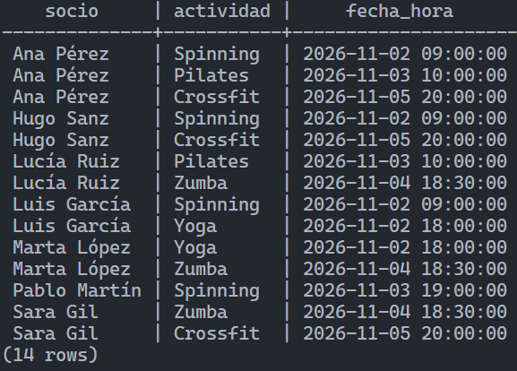

# FitVal · Base de datos de un gimnasio

Diseño y práctica de una base de datos para gestionar los planes, socios, tarjetas de acceso, clases y reservas de un gimnasio. El proyecto está hecho con **PostgreSQL**.

## Archivos

| Archivo | Contenido |
| --- | --- |
| [`gimnasio.sql`](gimnasio.sql) | Tablas, datos de prueba, comprobación de restricciones, consultas y cambios en los datos. |
| [`respuestas.md`](respuestas.md) | Explicaciones del diseño y respuestas a los ejercicios. |
| [`captura-b4-6.png`](captura-b4-6.png) | Resultado de la consulta de reservas con el socio y la clase. |

## Modelo de datos

| Relación | Tipo | Cómo se representa |
| --- | --- | --- |
| Planes → socios | 1:N | `socios.plan_id` |
| Socios → tarjetas | 1:1 | `tarjetas.socio_id`, con `UNIQUE` |
| Monitores → clases | 1:N | `clases.monitor_id` |
| Socios ↔ clases | N:M | Tabla `reservas` |
| Monitores ↔ especialidades | N:M | Tabla `monitor_especialidades` |

Las claves ajenas conectan las tablas. Las restricciones `UNIQUE` evitan duplicados, como dos tarjetas para un mismo socio o dos reservas de la misma clase por el mismo socio.

## Cómo probarlo

Con el contenedor de PostgreSQL de la clase:

```powershell
docker start postgres-sql
docker exec -it postgres-sql psql -U alumno -d academia
```

Dentro de `psql`, crea la base de datos y conéctate a ella:

```text
CREATE DATABASE gimnasio;
\c gimnasio
```

Abre [`gimnasio.sql`](gimnasio.sql) y ejecuta sus secciones en este orden:

1. **B1:** crea las ocho tablas.
2. **B2:** carga los datos de prueba una sola vez.
3. **B3:** ejecuta cada prueba por separado. Los errores son esperados: muestran que las claves protegen los datos.
4. **B4:** consulta los datos. Hazlo antes de B5 para ver los resultados iniciales.
5. **B5:** modifica y borra los registros indicados en el ejercicio.

La consulta **B4.6** muestra las reservas junto al nombre del socio y la clase:


